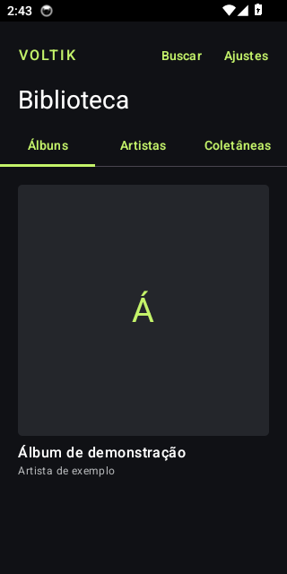
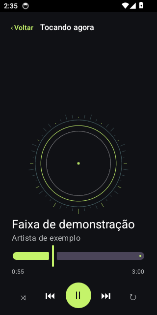
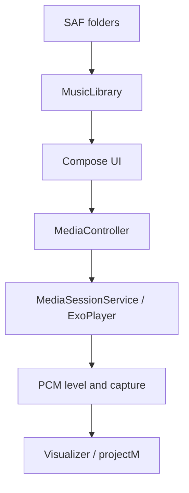

# Voltik ⚡

**An Android player for local MP3 music with a reactive visualizer.**

**Source code:** this repository's `main` branch · [CI](https://github.com/luisfelipealves/voltik/actions)

## Experience

Choose music folders with Android's Storage Access Framework, browse albums and play through a persistent media session. The visualizer reads decoded PCM levels from the playback pipeline, with an experimental projectM/MilkDrop rendering path. The Android notification provides playback controls through Media3. The interface is built with Jetpack Compose.

| Library | Player |
| --- | --- |
|  |  |

*Captured from the current production Compose UI in an API 34 emulator with explicitly supplied demonstration album and track metadata. The screenshots verify the screen layouts, not actual audio playback or projectM rendering. Physical-device playback remains a separate validation.*

## Architecture



`MusicLibrary.kt` reads user-selected document trees and album metadata. `PlaybackService.kt` owns ExoPlayer and the MediaSession, allowing playback beyond the activity lifetime. Its audio processor observes decoded PCM for visualization. `MilkdropCoordinator.kt`, `ProjectMPanel.kt` and related classes manage the optional graphics path. Tests cover playback, SAF behavior, album policy and navigation.

## Build and try it

Prerequisites: JDK 17, Android SDK 35 and Gradle installed locally. The experimental build refers to `app/libs/projectM-TV-core-2.3.57.aar`, which is not committed, and this branch has no Gradle wrapper. Obtain the AAR and place it at that path before building; a fresh clone is not yet reproducibly buildable.

```bash
git clone https://github.com/luisfelipealves/voltik.git
cd voltik
gradle testDebugUnitTest assembleDebug
```

Install `app/build/outputs/apk/debug/app-debug.apk`, grant access to a folder containing MP3 files, and select a track. The SAF grant is user-controlled. The current versioned code identifies itself as `0.1.9-experimental`. The requested landscape layout and notification tap navigation should be validated separately before they are claimed as shipped.

## How we built it

I defined the visual direction and tested APKs on my Android phone. We iterated on album browsing, playback, proportions and visual motion from hands-on feedback. AI assisted with Kotlin/Compose implementation and test automation, while I approved the interaction and visual results. The current branch provides a code checkpoint; newer requested changes should be pushed before claiming them in a CV.

## Status and portfolio snapshot

Experimental Android app. This repository is private, so its URL will not open for a recruiter without access. **Highlights:** Kotlin, Compose, Media3/ExoPlayer, SAF, MediaSession, PCM-driven graphics and device-based iteration.
